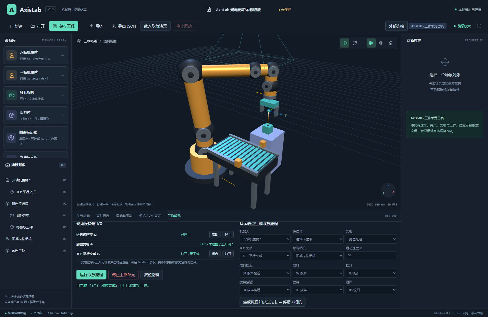

# AxisLab 2.1 · 机械臂工作单元仿真

**AxisLab 是主体应用。** 它自身运行机械臂、传送带、夹爪、光电传感器和设备逻辑，可以独立完成示教取放。模拟相机直接连接 VisionMaster 采图、编辑流程和调试标定；WPF 仅保留为可选外部客户端示例，不参与默认启动，也不是运行依赖。



本轮功能与验证范围见 [2.1 验收记录](docs/2.1-验收记录.md)。

```text
AxisLab
 ├─ 三维场景、三轴/六轴、尺寸、运动与示教
 ├─ 传送带 → 光电 → 停带/触发相机 → 夹爪取放
 ├─ 内置设备动作表、流程执行、I/O 状态与停止
 ├─ 虚拟 GigE 相机 ──图像──→ VisionMaster：检测、标定、定位
 └─ Modbus TCP / HTTP ←──→ PLC、VM、C#、其他上位机（WPF 可选）
```

## 下载与第一遍使用

从 [Releases](https://github.com/Craftr66/AxisLab/releases) 下载 `AxisLab-2.1.0-win-x64.zip`，完整解压，运行 `Start-AxisLab.cmd` 或 `AxisLab.exe`。只打开 AxisLab。

环境为 Windows x64、WebView2 Runtime；发布包自带 .NET 10，不需要 WPF Demo、.NET 9 或 VisionMaster SDK 才能运行仿真与示教。VM 的软件、相机运行库和加密狗由使用者自行安装。

1. 点击工具栏 **载入取放演示**，或导入 `Samples/workcell-pick-place.scene.json`。
2. 打开底部 **工作单元**，点击 **运行取放流程**。
3. 物品沿传送带前进；光电遮挡后 DI 变为 1、停止传送带并触发一次实际相机曝光。
4. 机器人依次接近、抓取、抬升、转移、放下，再退到安全点。工件随夹爪移动，释放后留在工位。
5. 完成后点击 **复位物料**，可再次运行。停止按钮会取消流程、停止机器人和输送，已夹持物品保持夹持。

演示自带六个真实示教点和 13 个动作步骤。**示教抓放使用已记录的点位**，因此无需 VM 连接也可运行；本阶段没有把 VM 检测结果冒充成取放依据。

## 设备与内部逻辑

| 设备 | 已实现行为 | 对外接口 |
| --- | --- | --- |
| 六轴 6R / 三轴 3R | 尺寸、FK/IK、关节/位姿运动、MoveL、工具与工件坐标、示教及回放 | Modbus 与 HTTP |
| 传送带 | 沿局部 +X 输送带面上的工件、速度、启动/停止 | 速度 DO 命令及状态寄存器 |
| 平行夹爪 | 挂载机器人 TCP，开合、捕获范围检查、保持/释放工件 | 开合 DO、夹持状态与关联物料 |
| 光电 | 检测体积内物品遮挡、DI、上升沿计数；可绑定停带和相机 | DI、计数、关联物料 |
| 可抓取工件 | 输送、刚性夹持跟随、释放到工位、显式复位 | 世界位姿 |
| 模拟相机 | 独立安装或挂到法兰/TCP，针孔成像、PNG、曝光姿态、虚拟 GigE | HTTP 图像、VM 直接采图 |

“设备动作表”包含传送带速度、等待光电上升沿、等待触发图像完成、运动到示教点、夹爪开合和延时。可修改步骤、设备、点位、值与超时，再点 **应用动作表 → 保存工程**。取放生成器负责把六个示教点组合成流程，并绑定光电停带/相机；它不依赖旧积木编辑器。

机器人运动前检查示教点有效性、整条路径和基础碰撞。工作单元运行期间锁定编辑与外部抢控；故障、超时、相机失败或控制被撤销会停止流程和传送带。外部 Modbus 启动的传送带受 5 秒心跳及断线停止约束。

详细操作见 [工作单元与示教取放](docs/工作单元与示教取放.md)。

## 模拟相机直接接入 VisionMaster

1. AxisLab 的 **相机 / VM 直采** 选择相机和本机网卡，点击 **发布虚拟 GigE 相机**。
2. VM 相机管理连接 `AxisLabCam / AXISLAB001`，图像源选相机。
3. 手动调试采图：TriggerMode=On，TriggerSource=Software，在 VM 内运行图像源/流程。
4. 光电触发：TriggerMode=On，TriggerSource=Line0。先让 VM 进入采集等待，再在 AxisLab 运行取放流程。
5. 在 VM 中自行添加检测、N 点标定、手眼/坐标转换等模块；AxisLab 不负责替 VM 求解视觉标定。

AxisLab 相机页还可 **保存 PNG、导出帧信息、导出标定观测**。标定观测包含同一次曝光的机械臂关节、法兰/TCP 矩阵和图像身份，排除相机安装真值和内参；配合示教动作，可在不打开 WPF 的情况下记录标定数据。完整帧信息仍供仿真调试使用。

当前 GigE 是实验实现：单路、Mono8、同机采流。多个场景相机可以添加，但本机一次发布一个 GigE 相机实例。已验证 tun0 接口；普通 WLAN 过滤驱动可能无法同机回传。软件不会修改网卡、驱动或防火墙。3956 被旧相机服务占用时，请先在旧入口停止该实例。

参见 [VM 直接采图与标定](docs/VM直接采图与WPF结果通信.md)。该文件保留旧文件名便于已有链接使用，内容已改为 AxisLab 主导。

## 外部 Modbus 与 C# 连接

地址以 AxisLab 顶部 **外部连接** 为准。HTTP、Modbus 是不同端口；客户端可通过 HTTP 查询实际 Modbus 端口。Modbus 协议仍为 v1，扩展级别 2，Unit ID=1，03/06/16，零基 PDU 偏移，Float32 ABCD；应用版本寄存器 2=`0x0201`。

| 选择对象后读取 | 含义 |
| --- | --- |
| 108，UInt16，仅仪器 | bit0 传送带运行，bit1 光电 DI，bit2 夹爪闭合，bit3 有关联物料 |
| 110—111，UInt32，仅仪器 | 光电上升沿计数 |
| 112—113，Float32，仅仪器 | 传送带速度，mm/s |
| 114，UInt16，仅仪器 | 关联工件编号，0=无 |
| 124—127，全局 | 流程状态、当前步、总步数、错误码 |

相机的 108—117 仍按旧版解释为内参/分辨率，必须先判断设备类型。新增类型：30 传送带、31 夹爪、32 光电、33 工件。新增命令：10 传送带、11 夹爪、12 启动内部流程、13 停止内部流程；旧机器人命令 1—9 保持。

```powershell
$axisUrl='http://127.0.0.1:软件显示的HTTP端口'
dotnet run --project samples/ModbusClient -- $axisUrl list
dotnet run --project samples/ModbusClient -- $axisUrl io 4
dotnet run --project samples/ModbusClient -- $axisUrl conveyor 2 80 5
dotnet run --project samples/ModbusClient -- $axisUrl grip 5 open
dotnet run --project samples/ModbusClient -- $axisUrl cell-start 1
dotnet run --project samples/ModbusClient -- $axisUrl cell-stop 1
```

以上编号对应演示，自己搭建的场景以实际编号为准。VM 或其他外部程序也可经既有位姿命令控制机器人；需先停止内部流程、接管机器人并维护心跳。当前内置演示不等待 VM 返回定位坐标，视觉结果参与自动抓放的内部握手作为下一阶段。

详见 [工作单元 Modbus 扩展](docs/工作单元Modbus扩展.md)、[既有 Modbus 协议](docs/ModbusTCP操作协议v1.md)、[运动与示教接口](docs/运动与示教接口.md)。

## 构建与测试

安装 .NET 10 SDK、Node.js 22+ 和 pnpm。

```powershell
pnpm install --frozen-lockfile
powershell -NoProfile -ExecutionPolicy Bypass -File scripts/build.ps1
powershell -NoProfile -ExecutionPolicy Bypass -File scripts/check.ps1
# 需要本机 Edge 和有效本机 IPv4：原功能与完整工作单元回归
powershell -NoProfile -ExecutionPolicy Bypass -File scripts/check.ps1 -Ui
# 发布独立 AxisLab，不需要 VM SDK 或 WPF
powershell -NoProfile -ExecutionPolicy Bypass -File scripts/publish.ps1
```

可选客户端用 `scripts/build.ps1 -IncludeWpf` 单独加编；旧 VM 结果插件用 `-WithVisionMaster`，仅供外部集成参考，不是当前相机直采的前提。开发网页服务用 `start.ps1`。

```text
src/Core           场景、机械臂、仪器运行、设备动作表、Modbus
src/Host           HTTP/Modbus、仿真时钟、相机实例管理
src/Frontend       AxisLab 三维场景、示教、工作单元、VM 相机入口
src/Desktop        独立桌面应用
src/VirtualCamera  GigE 适配器（Software / Line0）
src/WpfDemo        可选外部上位机示例
src/VmDirectLink   旧外部结果发布参考，不参与 AxisLab 运行
tests              核心、通信、工作单元测试
samples            场景与 C# 外部连接示例
```

工程保存格式为 schema 8，兼容导入 1—7；设备、仪器配置、相机触发绑定、示教点和动作表一起保存，运行中状态不会自动恢复。升级前保留原工程。缓存、个人工程、历史备份和厂商 SDK 不进入公开仓库。

当前仿真采用理想输送和刚性夹持，光电按检测体积判断；不包含摩擦、惯性、落体与微秒级电气时序。多工件供料、多路 GigE、内部 VM 定位握手、空间标定向导见 [后续开发大纲](docs/后续开发大纲.md)。项目未附开源许可；第三方组件按各自许可使用。
